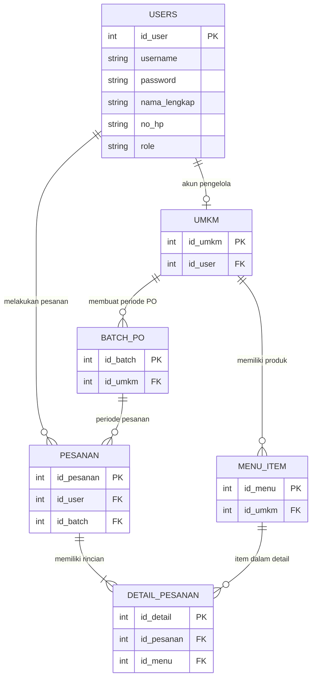
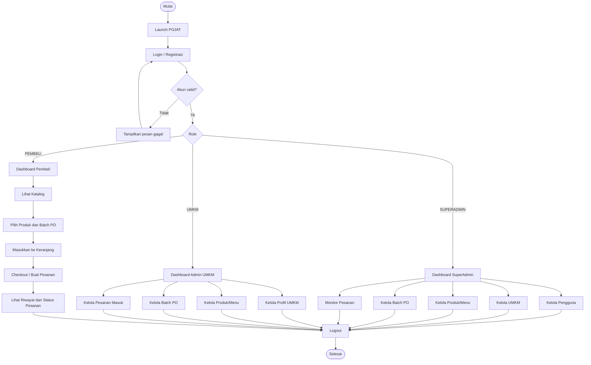
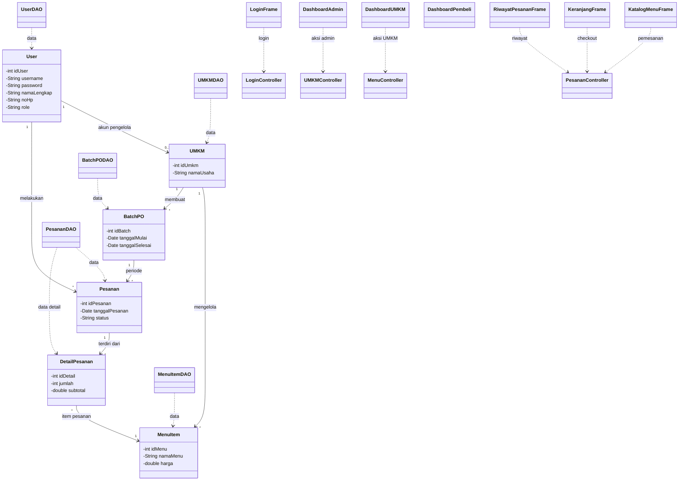

# 🛍️ POJAT

### Platform Pemesanan Produk UMKM Jatinangor

**Pesan Lebih Mudah, Dukung UMKM Jatinangor!**

POJAT (Platform Pemesanan Produk UMKM Jatinangor) merupakan aplikasi desktop yang dirancang untuk memfasilitasi pengelolaan UMKM dan pemesanan produk UMKM di wilayah Jatinangor.

Aplikasi ini menghubungkan tiga jenis pengguna, yaitu SuperAdmin, Admin UMKM, dan Pembeli, dalam satu sistem yang terintegrasi. Melalui POJAT, pengelolaan informasi UMKM, produk, periode pemesanan, dan transaksi diharapkan dapat dilakukan secara lebih terstruktur dan efisien.
---
## 📖 2. Background

UMKM memiliki peran penting dalam aktivitas ekonomi lokal, termasuk di wilayah Jatinangor. Namun, pengelolaan informasi usaha, produk, periode pemesanan, serta transaksi dapat menjadi kurang praktis apabila dilakukan secara terpisah atau masih manual. Pembeli juga membutuhkan cara yang lebih mudah untuk menemukan produk UMKM dan melakukan pemesanan.

POJAT dikembangkan sebagai aplikasi desktop yang mempertemukan pengelola UMKM dan pembeli dalam satu platform. Sistem ini menyediakan pengelolaan data UMKM dan produk, informasi Batch PO, serta proses pemesanan dan pemantauan pesanan. Dengan dukungan aplikasi terintegrasi, POJAT diharapkan dapat membantu proses operasional UMKM menjadi lebih terstruktur dan memudahkan pembeli dalam melakukan pemesanan produk.

## 📌 3. Project Overview
| Informasi | Keterangan |
|---|---|
| Nama Proyek | POJAT |
| Kepanjangan | Platform Pemesanan Produk UMKM Jatinangor |
| Kategori | Desktop Application |
| Bahasa Pemrograman | Java |
| GUI Framework | Java Swing |
| Database | MySQL / MariaDB |
| Database Connector | JDBC |
| Database Environment | Laragon |
| IDE | Apache NetBeans |
| Version Control | Git & GitHub |

## 🎯 4. Project Objectives

POJAT dikembangkan dengan beberapa tujuan utama:

1. Memfasilitasi pengelolaan data UMKM dalam satu platform.

2. Memudahkan pelaku UMKM dalam mengelola informasi toko dan produk.

3. Menyediakan sistem pemesanan produk yang terstruktur.

4. Mempermudah pembeli dalam melihat katalog dan melakukan pemesanan.

5. Mendukung digitalisasi dan pengembangan UMKM di wilayah Jatinangor.

## 👥 5. User Roles

POJAT memiliki tiga jenis pengguna dengan hak akses yang berbeda.

### 5.1 SuperAdmin

Bertanggung jawab mengelola dan memantau sistem secara keseluruhan.

- Mengakses dashboard SuperAdmin.

- Mengelola data pengguna.

- Mengelola data UMKM.

- Memantau data produk.

- Memantau Batch PO.

- Melihat data pesanan.

### 5.2 Admin UMKM

Bertanggung jawab mengelola toko dan produk UMKM masing-masing.

- Mengakses dashboard Admin UMKM.

- Mengelola profil UMKM.

- Menambahkan produk atau menu.

- Mengubah informasi produk.

- Menghapus produk.

- Membuat dan mengelola Batch PO.

- Melihat pesanan yang masuk.

### 5.3 Pembeli

Menggunakan aplikasi untuk menemukan dan memesan produk UMKM.

- Melakukan registrasi dan login.

- Melihat katalog UMKM.

- Melihat produk yang tersedia.

- Melihat informasi Batch PO.

- Melakukan pemesanan.

- Melihat riwayat dan status pesanan.

## ✨ 6. Main Features
| Fitur | Deskripsi |
|---|---|
| Authentication | Login dan registrasi pengguna |
| Role-Based Access | Hak akses berdasarkan jenis pengguna |
| Dashboard | Tampilan informasi sesuai role |
| User Management | Pengelolaan data pengguna |
| UMKM Management | Pengelolaan data UMKM |
| Product Management | CRUD data produk atau menu |
| Batch PO Management | Pengelolaan periode pemesanan |
| Product Catalog | Menampilkan katalog produk UMKM |
| Order Management | Pengelolaan transaksi pemesanan |
| Order History | Melihat riwayat pemesanan |

Catatan: Daftar fitur merupakan rancangan awal dan akan disesuaikan dengan implementasi serta kebutuhan proyek.

## 🏗️ 7. System Architecture

POJAT menggunakan pemisahan komponen aplikasi untuk memudahkan pengembangan dan pemeliharaan sistem.

### Architecture Layers

1. ****View (Presentation Layer)****  

   Menampilkan antarmuka aplikasi menggunakan Java Swing.

2. ****Controller (Business Logic Layer)****  

   Mengatur alur aplikasi, validasi input, hak akses, dan proses bisnis.

3. ****Model (Data Layer)****  

   Merepresentasikan objek dan entitas yang digunakan dalam sistem.

4. ****DAO (Data Access Object)****  

   Menangani operasi database seperti Create, Read, Update, dan Delete.

5. ****JDBC Driver****  

   Menghubungkan aplikasi Java dengan database.

6. ****Database Server****  

   Menyimpan data aplikasi menggunakan MySQL atau MariaDB melalui Laragon.

## 🗄️ 8. Database Design

Database proyek menggunakan enam tabel utama dalam rancangan awal:
| No. | Nama Tabel | Fungsi |
|---|---|---|
| 1 | users | Menyimpan informasi akun pengguna |
| 2 | umkm | Menyimpan informasi UMKM |
| 3 | menu_item | Menyimpan data produk atau menu |
| 4 | batch_po | Menyimpan informasi periode pemesanan |
| 5 | pesanan | Menyimpan informasi transaksi pesanan |
| 6 | detail_pesanan | Menyimpan rincian produk dalam pesanan |

****Nama database rancangan:**** `pojat_db`

> Struktur tabel, nama kolom, tipe data, primary key, dan foreign key harus mengikuti skema database aktual yang digunakan dalam proyek.

## 🗄️ 9. ERD (Entity Relationship Diagram)

ERD berikut merupakan gambaran konseptual hubungan enam tabel utama POJAT. Detail kolom, nama foreign key, dan kardinalitas perlu disesuaikan kembali dengan skema database aktual.



> **Catatan:** ERD ini bersifat konseptual berdasarkan daftar tabel dan fitur pada README. Pastikan relasi dan kolom cocok dengan SQL/database aktual sebelum dianggap final.

## 🔄 10. Application Flowchart

Flowchart berikut menunjukkan alur umum aplikasi berdasarkan role pengguna.



## 🧱 11. Class Diagram

Class diagram berikut merupakan gambaran konseptual kelas pada POJAT yang dikelompokkan berdasarkan Model, DAO, Controller, dan View. Nama atribut, method, dan controller perlu disesuaikan dengan source code aktual.



> **Catatan:** Diagram ini merupakan draft arsitektur, bukan reverse-engineering seluruh class aktual. Perbarui nama class, atribut, method, dan hubungan berdasarkan implementasi final.

## 💻 12. Technologies Used
| Teknologi | Kegunaan |
|---|---|
| Java | Bahasa pemrograman utama |
| Java Swing | Membangun antarmuka desktop |
| MySQL / MariaDB | Sistem manajemen database |
| JDBC | Koneksi Java dengan database |
| Laragon | Menjalankan database server lokal |
| Apache NetBeans | IDE untuk pengembangan |
| Git | Version control |
| GitHub | Penyimpanan dan kolaborasi proyek |

## 📂 13. Project Structure

Struktur folder yang direncanakan:

```text

POJAT/

│

├── src/

│   ├── config/

│   │   └── DatabaseConnection.java

│   │

│   ├── model/

│   │   ├── User.java

│   │   ├── UMKM.java

│   │   ├── MenuItem.java

│   │   ├── BatchPO.java

│   │   └── Pesanan.java

│   │

│   ├── dao/

│   │   ├── UserDAO.java

│   │   ├── UMKMDAO.java

│   │   ├── MenuItemDAO.java

│   │   ├── BatchPODAO.java

│   │   └── PesananDAO.java

│   │

│   ├── controller/

│   │

│   ├── view/

│   │   ├── LoginView.java

│   │   ├── SuperAdminDashboard.java

│   │   ├── UMKMDashboard.java

│   │   └── PembeliDashboard.java

│   │

│   ├── util/

│   │

│   └── Main.java

│

├── database/

│   ├── schema.sql

│   ├── seed.sql

│   └── queries.sql

│

├── docs/

│   ├── SYSTEM_ARCHITECTURE.md

│   ├── FEATURE_SPECIFICATION.md

│   ├── TESTING_DOCUMENTATION.md

│   └── DATABASE_DESIGN.md

│

├── screenshots/

│   └── testing/

│

├── .gitignore

├── README.md

└── LICENSE

```

Struktur di atas merupakan rancangan organisasi kode. File dan package dapat bertambah atau berubah selama pengembangan.

tambah latar belakang, tambah erd, tambah flowchart, tambhan class diagram

## ⚙️ 14. Installation & Setup

### Prerequisites

Pastikan perangkat telah memiliki:

- Java Development Kit (JDK).

- Apache NetBeans IDE.

- Laragon.

- MySQL atau MariaDB.

- JDBC Driver yang sesuai dengan database.

### Step 1 — Clone Repository

```bash

git clone <URL_REPOSITORY_GITHUB>

```

### Step 2 — Start Database Server

1. Buka Laragon.

2. Jalankan service database.

3. Pastikan MySQL atau MariaDB aktif.

### Step 3 — Create Database

Buat database dengan nama:

```sql

CREATE DATABASE pojat_db;

```

Import struktur tabel melalui file SQL yang disediakan dalam folder `database/`.

### Step 4 — Configure JDBC

Sesuaikan konfigurasi database pada:

```text

src/config/DatabaseConnection.java

```

Pastikan URL, port, username, password, dan JDBC Driver sesuai dengan konfigurasi lokal.

### Step 5 — Open Project

1. Buka Apache NetBeans.

2. Pilih Open Project.

3. Pilih folder POJAT.

4. Pastikan JDBC Driver telah ditambahkan ke Libraries.

### Step 6 — Run Application

Jalankan program melalui file `Main.java`.

## 🧪 15. Testing

Pengujian dilakukan menggunakan metode Black Box Testing untuk memastikan fitur berjalan sesuai kebutuhan.

Beberapa skenario pengujian yang direncanakan:
| No. | Skenario | Expected Result |
|---|---|---|
| 1 | Login SuperAdmin | Masuk ke dashboard SuperAdmin |
| 2 | Login Admin UMKM | Masuk ke dashboard Admin UMKM |
| 3 | Login Pembeli | Masuk ke dashboard Pembeli |
| 4 | Login dengan password salah | Sistem menampilkan pesan kesalahan |
| 5 | Menambahkan produk | Data tersimpan di database |
| 6 | Mengubah produk | Data berhasil diperbarui |
| 7 | Menghapus produk | Data terhapus sesuai aturan |
| 8 | Membuat Batch PO | Data Batch PO tersimpan |
| 9 | Melakukan pemesanan | Pesanan tercatat di database |
| 10 | Input tidak valid | Sistem menolak input dan menampilkan pesan |

Hasil aktual dan status pengujian akan dicatat dalam `docs/TESTING_DOCUMENTATION.md` setelah setiap skenario dijalankan.

## 📚 16. Project Documentation

Dokumentasi tambahan tersedia dalam folder `docs/`.
| File | Keterangan |
|---|---|
| SYSTEM_ARCHITECTURE.md | Penjelasan arsitektur sistem |
| FEATURE_SPECIFICATION.md | Daftar fitur dan spesifikasi aplikasi |
| TESTING_DOCUMENTATION.md | Skenario dan hasil pengujian |
| DATABASE_DESIGN.md | Penjelasan struktur dan relasi database |

## 🚧 17. Development Status

Status berikut merupakan checklist pengembangan, bukan klaim bahwa seluruh fitur sudah selesai.

- [x] Membuat repository GitHub.

- [x] Menyiapkan database lokal.

- [x] Membuat enam tabel database.

- [x] Menambahkan data dummy.

- [ ] Membuat project Java di NetBeans.

- [ ] Mengintegrasikan JDBC.

- [ ] Membuat fitur login dan registrasi.

- [ ] Membuat dashboard berdasarkan role.

- [ ] Mengimplementasikan CRUD menu.

- [ ] Mengimplementasikan CRUD Batch PO.

- [ ] Mengimplementasikan pemesanan.

- [ ] Melakukan pengujian seluruh fitur.

- [ ] Menyelesaikan dokumentasi proyek.

## 🔮 18. Future Development

Pengembangan selanjutnya dapat mencakup:

- Penyempurnaan tampilan antarmuka.

- Pengembangan fitur pencarian dan filter produk.

- Pengembangan monitoring transaksi.

- Penyempurnaan validasi dan keamanan data.

- Peningkatan pengalaman pengguna.

- Pengembangan fitur tambahan berdasarkan evaluasi kebutuhan UMKM.

## 🤝 19. Contribution

Pengembangan POJAT dilakukan dengan menerapkan pengelolaan kode menggunakan Git dan GitHub.

Setiap perubahan kode sebaiknya:

1. Memiliki tujuan yang jelas.

2. Mengikuti struktur package proyek.

3. Tidak merusak fungsi yang sudah berjalan.

4. Diuji sebelum digabungkan ke versi utama.

5. Disertai pembaruan dokumentasi jika diperlukan.

## 📄 20. License

Lisensi proyek akan ditentukan sesuai ketentuan pengembangan dan kepemilikan proyek.
---
<p align="center">
**POJAT**
</p>

## 🗄️ 9. ERD (Entity Relationship Diagram)

ERD berikut merupakan gambaran konseptual hubungan enam tabel utama POJAT. Detail kolom, nama foreign key, dan kardinalitas perlu disesuaikan kembali dengan skema database aktual.


## 🔄 10. Application Flowchart

Flowchart berikut menunjukkan alur umum aplikasi berdasarkan role pengguna.


## 🧱 11. Class Diagram

Class diagram berikut merupakan gambaran konseptual kelas pada POJAT yang dikelompokkan berdasarkan Model, DAO, Controller, dan View. Nama atribut, method, dan controller perlu disesuaikan dengan source code aktual.

