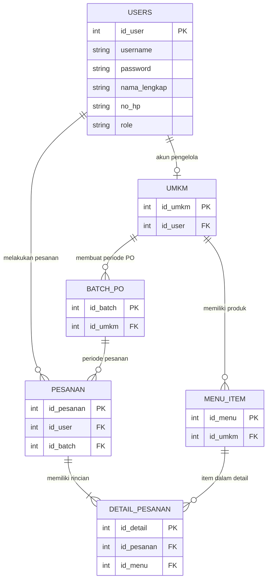

# POJAT

### Platform Pemesanan Produk UMKM Jatinangor

**Pesan Lebih Mudah, Dukung UMKM Jatinangor!**

POJAT (Platform Pemesanan Produk UMKM Jatinangor) merupakan aplikasi desktop yang dirancang untuk memfasilitasi pengelolaan UMKM dan pemesanan produk UMKM di wilayah Jatinangor.

Aplikasi ini menghubungkan tiga jenis pengguna, yaitu SuperAdmin, Admin UMKM, dan Pembeli, dalam satu sistem yang terintegrasi. Melalui POJAT, pengelolaan informasi UMKM, produk, periode pemesanan, dan transaksi diharapkan dapat dilakukan secara lebih terstruktur dan efisien.
---
## 1. Background

UMKM memiliki peran penting dalam aktivitas ekonomi lokal, termasuk di wilayah Jatinangor. Namun, pengelolaan informasi usaha, produk, periode pemesanan, serta transaksi dapat menjadi kurang praktis apabila dilakukan secara terpisah atau masih manual. Pembeli juga membutuhkan cara yang lebih mudah untuk menemukan produk UMKM dan melakukan pemesanan.

POJAT dikembangkan sebagai aplikasi desktop yang mempertemukan pengelola UMKM dan pembeli dalam satu platform. Sistem ini menyediakan pengelolaan data UMKM dan produk, informasi Batch PO, serta proses pemesanan dan pemantauan pesanan. Dengan dukungan aplikasi terintegrasi, POJAT diharapkan dapat membantu proses operasional UMKM menjadi lebih terstruktur dan memudahkan pembeli dalam melakukan pemesanan produk.

## 2. User Roles

POJAT memiliki tiga jenis pengguna dengan hak akses yang berbeda.

### 2.1 SuperAdmin

Bertanggung jawab mengelola dan memantau sistem secara keseluruhan.

- Mengakses dashboard SuperAdmin.

- Mengelola data pengguna.

- Mengelola data UMKM.

- Memantau data produk.

- Memantau Batch PO.

- Melihat data pesanan.

### 2.2 Admin UMKM

Bertanggung jawab mengelola toko dan produk UMKM masing-masing.

- Mengakses dashboard Admin UMKM.

- Mengelola profil UMKM.

- Menambahkan produk atau menu.

- Mengubah informasi produk.

- Menghapus produk.

- Membuat dan mengelola Batch PO.

- Melihat pesanan yang masuk.

### 2.3 Pembeli

Menggunakan aplikasi untuk menemukan dan memesan produk UMKM.

- Melakukan registrasi dan login.

- Melihat katalog UMKM.

- Melihat produk yang tersedia.

- Melihat informasi Batch PO.

- Melakukan pemesanan.

- Melihat riwayat dan status pesanan.

## 3. ERD (Entity Relationship Diagram)

ERD berikut merupakan gambaran konseptual hubungan enam tabel utama POJAT. Detail kolom, nama foreign key, dan kardinalitas perlu disesuaikan kembali dengan skema database aktual.

## 🔄 4. User Flow

## 5. Class Diagram

